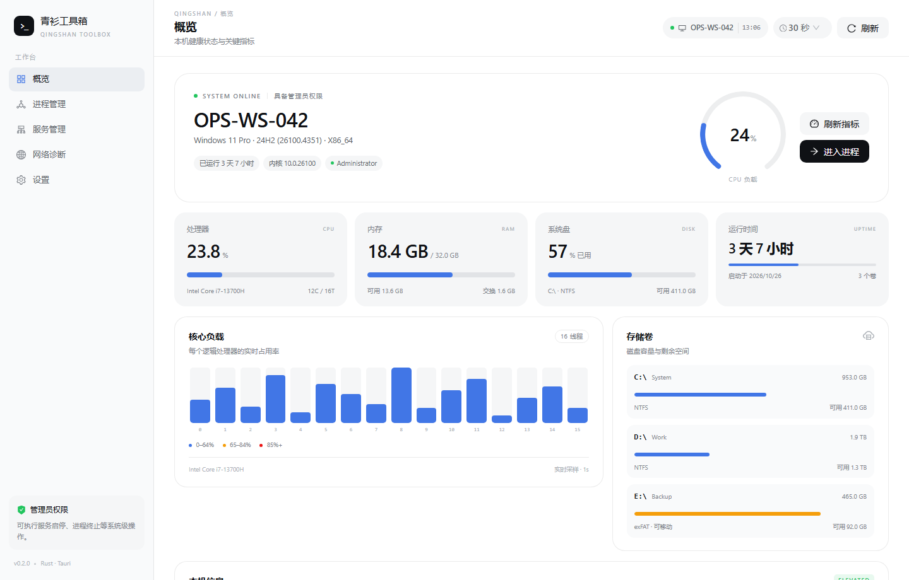

# 青衫工具箱 · 企业 DevOps 工作台

青衫工具箱 是一个面向企业员工与运维团队的 DevOps 工具，规划为**桌面端 + 网页端**两种形态：

- **桌面端（当前阶段）**：Rust + Tauri 2 构建的 Windows 桌面运维工作台，提供系统概览、进程管理、服务管理、网络诊断与权限模型。
- **网页端（后续阶段）**：统一处理 Terraform、Ansible、GitHub Actions、Jenkins、Dockerfile、Shell 脚本与 Git 数据记录，形成可审计的 DevOps 控制面。

> 源码仓库：<https://github.com/DragonTsunami/qingshan-toolbox>

> 状态：v0.2.0，**当前处于框架冻结阶段**。Rust 领域层 / 应用服务层 / Windows 适配层 / Tauri 命令层 / React 控制台已贯通；24 项 Rust 测试、12 项前端测试通过。release 桌面窗口已在 `C:\QingshanToolbox` 真实启动验证，界面采用与 **DeepSeek Harness** 同源的中性色 token、黑色主按钮与品牌蓝强调。

> **阶段约定：只做框架，不做内容。** 在 [`docs/framework.md`](docs/framework.md) 的验收清单关闭前，不新增业务页面，也不开始网页端实现。现有五个页面仅作为框架参考实现。

> **打开桌面端**：双击桌面快捷方式 **青衫工具箱**，或运行 `C:\QingshanToolbox\QingshanToolbox.exe`。`http://127.0.0.1:1421` 只是前端预览，不是交付形态；桌面端是独立的 Windows exe，不需要 Node/Vite。



更多界面：[深色主题](docs/images/overview-dark.png) · [进程管理](docs/images/processes.png) · [服务管理](docs/images/services.png) · [网络诊断](docs/images/network.png) · [设置](docs/images/settings.png)

---

## 1. 当前能力

| 模块 | 能力 | 说明 |
| --- | --- | --- |
| 概览 | 主机、系统、CPU、内存、交换区、磁盘、运行时间 | 自动刷新间隔可选 **1 / 3 / 5 / 10 / 30 / 60 秒**，支持手动刷新 |
| 进程 | 列表、搜索、按 CPU/内存/名称排序、结束进程 | 自动刷新跟随全局间隔；支持强制终止；拦截对 青衫工具箱 自身的操作 |
| 服务 | 枚举 Windows 服务、启停、重启、启动类型 | 操作后等待状态收敛（最长 20 秒）；需要管理员权限 |
| 网络 | 接口、IP/MAC、流量、TCP 端口检测、DNS 解析 | 仅使用系统解析器与 TCP 握手，不执行任意命令 |
| 权限 | 检测 UAC 提权状态、以管理员身份重启 | 通过 `ShellExecuteW(runas)` 触发 |
| 体验 | 深色/浅色主题、跟随系统、DSH 同源视觉、WebView2 | 主题记忆在本机，支持 `?theme=dark` 预览 |

**尚未实现（见路线图）**：日志检索、启动项、计划任务、磁盘清理、软件清单、资产上报、远程协助。

---

## 2. 技术选型

| 层 | 技术 | 选择理由 |
| --- | --- | --- |
| 桌面框架 | Tauri 2 | Rust 内核、系统 WebView2、安装包体积小、权限模型清晰 |
| 领域层 | 纯 Rust（`devops-core`） | 不依赖 UI 与平台 API，可被桌面端、未来网页后端复用 |
| 平台层 | `sysinfo` + `windows` crate | 系统指标跨平台；服务/提权使用原生 Win32 API |
| 前端 | React 18 + TypeScript + Ant Design 5 + Vite | 企业级表格/表单组件成熟，后续网页端可复用设计语言与部分组件 |
| 构建 | Cargo workspace + npm | Rust 与前端独立构建，Tauri 负责嵌入产物 |

为什么不是纯 Rust GUI（egui/iced）？桌面端后续要与网页端共享领域模型、命令契约与设计系统，Tauri 的 Web 前端复用价值更高，同时保留 Rust 的系统能力与安全性。

### 视觉语言

界面以 **DeepSeek Harness** 的 `--dsw-*` 主题 token 为基准：

- 中性偏蓝灰阶负责背景/侧栏/卡片层级，品牌蓝 `#4176e6` 只用于链接、焦点、活动图标与数据强调。
- 主按钮使用 ink（浅色 `#0f1115` / 深色 `#f9fafb`），不使用蓝色大按钮。
- 圆角 12–24px、1px 低透明度描边、无渐变与发光；状态使用「圆点 + 中性文字」。
- 品牌字 Montserrat，界面使用系统字体栈。
- 首次启动跟随系统主题，切换后持久化；开发时可用 `?theme=dark` 强制预览。

完整 token 表与组件规则见 [`docs/design-system.md`](docs/design-system.md)。

---

## 3. 仓库结构

```text
DeepSeek-Devops/
├─ desktop/
│  ├─ Cargo.toml                 # Rust workspace
│  ├─ crates/
│  │  ├─ devops-core/            # 领域模型、trait、错误（无平台/UI 依赖）
│  │  ├─ devops-app/             # 应用服务层 OpsService（可注入、可测试）
│  │  ├─ devops-testkit/         # 全能力 Mock 与 fixtures
│  │  └─ devops-platform/        # Windows 适配器（sysinfo / Win32）
│  ├─ src-tauri/                 # Tauri 壳、命令层、能力声明
│  └─ ui/                        # React 控制台（Vite + Vitest）
├─ docs/
│  ├─ architecture.md            # 分层、命令契约、安全模型
│  ├─ framework.md               # 框架范围、测试矩阵、验收清单
│  ├─ design-system.md           # DSH 同源视觉 token 与组件规则
│  └─ roadmap.md                 # 桌面端 + 网页端演进路线
├─ .github/workflows/ci.yml      # Linux core / Windows workspace / UI
├─ scripts/
│  ├─ build-desktop.ps1          # 本机便携工具链构建脚本
│  ├─ registry-proxy.mjs         # 本机 Cargo 稀疏索引代理（仅特殊网络环境）
│  └─ ...
└─ README.md
```

---

## 4. 本地开发

### 4.1 标准环境（推荐）

前置：Rust stable、Node.js 20+、Microsoft C++ Build Tools、WebView2 Runtime（Windows 11 自带）。

```powershell
cd desktop/ui
npm install
npm run build          # 产出 ui/dist，供 Tauri 嵌入
npm test               # Vitest：工具函数 + Mock API 契约

cd ../src-tauri
cargo build --release --features custom-protocol
# 产物：desktop/target/release/opsdeck.exe（独立 exe，内嵌前端）
```

`custom-protocol` 必须开启：否则 Tauri 会加载 `build.devUrl`（`http://localhost:1420`），窗口显示“无法访问此页面”。开发时 `cargo run` 可配合 `npm run dev` 使用 HMR；交付/分发必须用 release + `custom-protocol`。

### 4.2 当前这台受限机器

该机器没有 Rust / MSVC / Windows SDK，也没有管理员权限。仓库因此内置了一套**完全位于 `.toolchain/` 的便携构建环境**：

- Rust 1.99.1 `x86_64-pc-windows-gnu`，安装在 `.toolchain/rustup`
- 链接器使用 Rust 自带的 `ld.lld`（GNU 工具链自带的 gcc 驱动在该机器上不可用）
- `windres` 从 MSYS2 binutils 中按需提取，用于编译 Windows 图标资源
- Cargo 通过本地 `scripts/registry-proxy.mjs` 访问稀疏索引（本机 schannel 无法获取 TLS 凭据）

构建命令：

```powershell
# 0. 仅本机需要：建立 ASCII 盘符（GNU dlltool 不支持中文路径）
subst R: "C:\Users\青衫\Documents\DeepSeek-Devops"

# 1. 启动本地 Cargo 索引代理（首次或依赖变更时）
node scripts/registry-proxy.mjs

# 2. 构建前端
cd desktop/ui
npm install
npm run build

# 3. 构建并运行桌面端（独立 exe，不依赖 Vite）
cd ../..
.\scripts\build-desktop.ps1 -Release -Run
```

`build-desktop.ps1` 会自动设置 `CARGO_HOME`、`RUSTUP_HOME`、`RUSTFLAGS`、`CARGO_TARGET_DIR`、`PATH` 与临时目录，不修改系统环境变量。

> 这套环境是环境适配，不是项目架构的一部分。在具备 MSVC 的机器上直接使用标准方式即可，无需 `.toolchain/`。

### 4.3 本机验证记录

| 验证项 | 结果 |
| --- | --- |
| `cargo check`（全 workspace，含 Tauri 2.12） | 通过 |
| `cargo build --release --features custom-protocol` → `desktop/dist/QingshanToolbox.exe` | 通过（6.7 MB） |
| `cargo test --workspace` | 24 / 24 通过（core 5 + app 12 + platform 7） |
| `cargo clippy --workspace --all-targets -- -D warnings` | 通过 |
| `cargo fmt --all -- --check` | 通过 |
| 前端 `tsc --noEmit && vite build` | 通过 |
| 前端 `npm test`（Vitest） | 12 / 12 通过 |
| 刷新间隔选择（1/3/5/10/30/60 秒） | 已实现并持久化到本机 |
| 六个页面 / 两套主题 UI 渲染 | 已截图（`docs/images`） |
| 真实窗口启动 | **已通过**：release + `custom-protocol`，窗口标题 `青衫工具箱`，真实硬件数据渲染 |

集成测试覆盖：系统快照、当前进程可见、拒绝结束自身进程、Windows 服务枚举、网络接口、DNS 解析、关闭端口检测。应用层测试覆盖：参数转发、自进程保护、输入校验、错误传播、服务动作、提权流程。

---

## 5. 命令契约

前端只通过 Tauri `invoke` 调用**白名单命令**，不执行任意 Shell：

| 命令 | 参数 | 返回 |
| --- | --- | --- |
| `system_snapshot` | — | `SystemSnapshot` |
| `process_list` | — | `ProcessInfo[]` |
| `process_kill` | `pid`, `force?` | `void` |
| `service_list` | — | `ServiceInfo[]` |
| `service_action` | `name`, `action: start\|stop\|restart` | `ServiceInfo` |
| `network_interfaces` | — | `NetworkInterface[]` |
| `network_check_port` | `host`, `port`, `timeoutMs?` | `PortCheckResult` |
| `network_resolve` | `host` | `DnsLookupResult` |
| `app_info` | — | `AppInfo` |
| `is_elevated` | — | `boolean` |
| `set_window_theme` | `dark: boolean` | `void`（同步 Windows 标题栏明暗） |
| `relaunch_as_admin` | — | `void`（进程退出并由新实例接管） |

所有结构使用 `camelCase` 序列化，模型定义在 `devops-core/src/models.rs`，前端类型在 `desktop/ui/src/types.ts`，两端字段一一对应。

---

## 6. 安全基线

- 不提供“任意命令执行”入口；所有操作都是强类型命令。
- 结束进程前必须二次确认；青衫工具箱 自身 PID 被硬编码拦截。
- 服务启停依赖 Windows UAC，权限不足时返回明确错误，不在后台静默提权。
- 网络诊断只做 DNS 解析与 TCP 握手，不调用 `cmd/powershell`。
- 前端启用 Tauri capability 白名单；当前仅 `core:default`。
- CSP 目前为 `null`（本地资源、无远程加载），接入远程内容前必须收紧。

---

## 7. 后续规划（框架验收后进入内容阶段）

桌面端：

1. 日志采集与检索（Windows Event Log / 应用日志）
2. 启动项、计划任务、软件清单、磁盘清理
3. 资产上报与合规基线
4. 远程协助入口与工单系统对接

网页端：

1. Git 仓库与提交记录目录
2. Terraform / Ansible 执行与审批流
3. GitHub Actions / Jenkins 连接器
4. Dockerfile / Shell 静态检查与沙箱执行
5. RBAC、审计日志与多租户

详见 [`docs/framework.md`](docs/framework.md)（框架验收）、[`docs/roadmap.md`](docs/roadmap.md) 与 [`docs/architecture.md`](docs/architecture.md)。

---

## 8. 已知限制

- 当前仅提供 Windows 平台适配器；`devops-core` 已为跨平台预留 trait。
- 服务枚举/控制使用 Win32 API，未做服务依赖关系图。
- 无自动更新、代码签名与安装包流水线（后续接入 Tauri bundler + 企业签名）。
- 当前 release 从含中文的仓库路径直接启动不稳定，交付使用 ASCII 安装目录 `C:\QingshanToolbox`（桌面快捷方式已指向该目录）。
- 窗口级 E2E 已手动验证，但尚未接入自动化 UI 测试。
- 前端产物约 1 MB（Ant Design），后续按路由拆包。
- WebView2 默认数据目录为 `%LOCALAPPDATA%`；便携/受控终端可用环境变量 `QINGSHAN_WEBVIEW_DATA` 重定向（本机脚本已指向 `.toolchain/webview2`）。

## 9. License

MIT。界面中的 Montserrat 字体按 SIL OFL 授权，许可证见 [`desktop/ui/src/assets/fonts/OFL.txt`](desktop/ui/src/assets/fonts/OFL.txt)。
