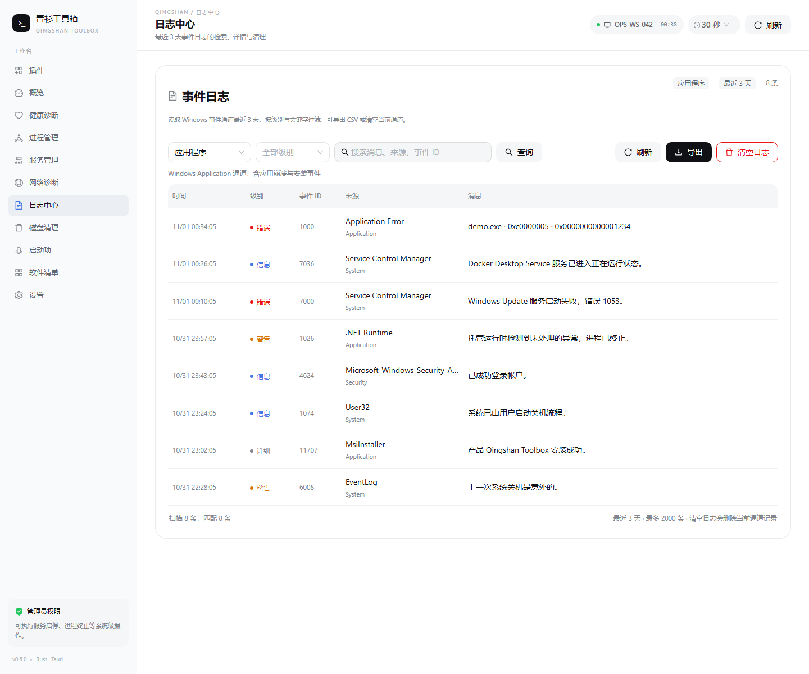
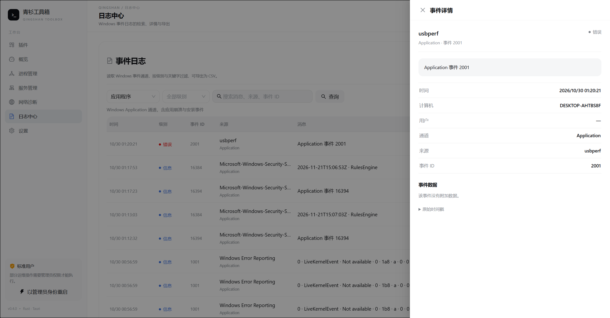

# 日志中心

日志中心是阶段 2 的第一个运维能力，入口位于侧栏「日志中心」。默认只读 Windows 事件日志；「清空日志」是显式确认后的管理员操作，不会执行任意 Shell。





## 能力

| 能力 | 说明 |
| --- | --- |
| 事件通道 | Application、System、Security |
| 级别过滤 | 严重、错误、警告、信息、详细、未知 |
| 关键字 | 消息、来源、通道、计算机、事件 ID、事件字段，大小写不敏感 |
| 时间范围 | 最近 3 天；后端时间窗 1–30 天 |
| 条数 | 单次最多 2000 条，超过显示截断提示 |
| 详情 | 事件来源、通道、计算机、用户、事件 ID、EventData 字段 |
| 导出 | CSV，UTF-8 BOM，默认写入 `%USERPROFILE%\Downloads` |
| 清空 | 清空当前事件通道，需管理员权限并二次确认，不可恢复 |

Security 通道需要管理员权限。标准用户查询时会显示「安全日志需要以管理员身份运行」，并提供「以管理员身份重启」按钮。

## 数据读取

Windows 适配器使用：

```text
wevtutil.exe qe <Application|System|Security> /q:"*[System[TimeCreated[timediff(@SystemTime) <= <ms>]]]" /c:<n> /rd:true /f:xml
wevtutil.exe cl <Application|System|Security>
```

- 时间窗在事件查询层完成，`3 天 = 259200000 ms`；不是先取最近 N 条再在内存截取。
- 使用 `CREATE_NO_WINDOW`，避免弹出控制台窗口。
- 先读取 XML，再由 `quick-xml` 解析 `<Event>`；不依赖本地语言包。
- `/c:<n>` 是硬上限 2000，超过时 `truncated = true`；级别/关键字在内存过滤。
- 输出兼容 UTF-8 BOM、UTF-16LE/BE；部分系统会把 `wevtutil` 输出为 UTF-16。
- `wevtutil cl` 清空通道不可恢复；Security 通道清空会被 Windows 审计。

## 分层

```text
LogsPage
  → api.queryLogs / exportLogs / clearLogs
  → Tauri commands::logs_query / logs_export / logs_clear   (spawn_blocking)
  → devops-app::LogService                     (参数校验)
  → devops-core::LogCenter trait
  → devops-platform::win::logs::LogCenterImpl  (wevtutil + quick-xml)
```

领域模型在 `devops-core/src/logs.rs`：

- `LogSource` / `LogSourceKind`
- `LogLevel` / `LogEntry` / `LogField`
- `LogQuery` / `LogBatch` / `LogExport`

应用层限制：

- `source` 不能为空；
- `limit` 1..=2000；
- `days` 1..=30；
- `keyword` 最多 128 字符；
- 导出最多 10000 条，空列表直接拒绝；
- 清空只接受 `application`、`system`、`security`，通道名由后端固定映射。

## 命令

| 命令 | 参数 | 返回 |
| --- | --- | --- |
| `log_sources` | — | `LogSource[]` |
| `logs_query` | `query: LogQuery` | `LogBatch` |
| `logs_export` | `entries: LogEntry[]` | `LogExport` |
| `logs_clear` | `source: string` | `void` |

所有字段按 camelCase 序列化，与 `desktop/ui/src/types.ts` 对应。

## 安全边界

- 不提供任意命令执行；`wevtutil` 的通道与参数由后端固定。
- 关键字只用于内存过滤，不拼接进命令行。
- 导出路径固定到 Downloads（不存在时落临时目录），不接受前端任意路径。
- 清空日志需管理员权限；前端二次确认，后端只接受三个固定通道。清空不可恢复，Security 通道会留下 Windows 审计记录。
- 日志内容可能包含路径、账户名等敏感信息；导出文件由用户自行保管。

## 测试

```powershell
cargo test -p devops-app -p devops-platform
npm test -- --run
```

平台测试会真实读取 Application 通道最近事件；Security 通道的行为取决于当前进程权限。
